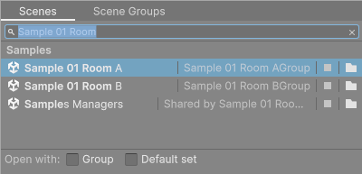
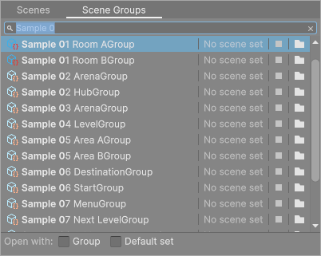

# Editor tools <!-- level 0 -->

Find, open and check scenes without the Project window: the [scene picker](term:scene-picker), the [Scene System page](term:scene-system-page), the setup window and the scene opening preferences.

## Scene picker <!-- level 0 -->

Open the scene picker from the main toolbar, just left of Play, to open or select any scene or scene group.

<!-- action open-picker "Open the scene picker" -->

<!-- marks 1@0.12,0.065 "Scenes tab"; 2@0.55,0.18 "Search"; 3@0.89,0.38 "Status button"; 4@0.96,0.38 "Folder button"; 5@0.27,0.92 "Open with: the scene opening preferences" -->

<!-- marks 1@0.37,0.04 "Scene Groups tab"; 2@0.72,0.17 "Its scene set"; 3@0.86,0.17 "Group check status" -->

- Unity hides a new toolbar element until you tick it: on Unity 6.3 right-click an empty part of the toolbar and tick Scene picker.
- Type to search; Enter opens the first row, Shift+Enter selects it, Tab switches tabs, Esc closes.
- It never changes Build Settings and never marks a scene dirty.

## Scene opening preferences <!-- level 0 -->

Opening a scene also opens what Play would load with it. Two preferences decide it: Open a main scene with its scene group, and Open a scene in no group with the default scene set.

<!-- action open-preferences "Open Preferences" -->

## Scene Groups Debugger <!-- level 0 -->

The Scene Groups Debugger on the Scene System page lists every [scene group](term:scene-group) with its problems and their fixes. Turn on the check before a build there.

<!-- action open-settings "Scene Groups Debugger" "Open the Debugger" -->

It starts with the check-before-a-build toggle, then lists every group: its name, main scene, scene set, problems with fixes, and Open group.

## Setup window <!-- level 0 -->

Tools > External Project Tools > Scene System > Set Up Scene System opens setup; once the project is set up it shows the Opening Scenes step only.

## Sample scene groups <!-- level 1 -->

Tick Sample scene group on a group whose scenes are only for the Editor. Its scenes open in Play but never go into a build.

<!-- action open-settings "Sample scene groups" "Open Sample scene groups" -->

If it goes wrong

- No scene picker on the toolbar → tick it once in the toolbar's menu.
- The picker opens nothing → Unity is compiling; the pick runs once Unity is idle.
- A group row is red → click its status button to select the group and see the fix.

## Details <!-- level 3 -->

The full behaviour of each tool, for when the sections above are not enough.

- **Scene opening preferences** (4B, split in 5A2). Opening a scene on its own also opens what Play would load with it, so the Hierarchy shows what Play loads. Two preferences decide it, per user and per project, both on by default:
  - **Open a main scene with its scene group:** a group's main scene opens its manager and shared scenes; a manager or shared scene opened alone opens the start scene group; a sample scene opens its sample scene group.
  - **Open a scene in no group with the default scene set:** a scene in no group opens the default scene set's manager and shared scenes.

  The launch scene opens nothing. The first time each is read, it takes the value of the old "Open the group with its main scene" preference, so a project keeps its choice. They act in edit mode only: Play always loads what a scene needs, and start-up never reads them. The opened scene stays active. Switching groups closes only scenes the tool opened that the new group does not need (unsaved ones get Unity's save prompt); scenes you opened by hand are never closed. Off in Play mode, builds, prefab mode, test runs, "Open group", and while Unity restores scenes. Never marks a scene dirty or changes Build Settings. Change them in Preferences > Abstract Pixel > Scenes, Tools > External Project Tools > Scene System (two toggles), setup's Opening Scenes step, or the scene picker's footer. Code: `Editor/OpenWithGroup/` (`SceneOpeningPreferences`, `SceneOpeningPreferenceStore`, `GroupScenesToOpen`).
- **Start-up section** (4B) on the Scene System page: start scene group (required), launch scene (optional) with "Create a launch scene…". The launch scene is kept at build index 0: choosing it puts it there, the page warns with Fix now when Build Settings were reordered, a build from the Build Profiles window puts it back first, and a scripted build that finds it moved puts it back and stops with a message (build again). The setup wizard has an optional Launch Scene step (none, a scene you have, or a new one).

- **Setup** (reworked in 5A2). In a project with no scene system settings asset, a short setup window opens once per Editor session (not in batch mode or test runs). Steps: 1 Scene System, 2 Settings Folder, 3 New Scenes, 4 Launch Scene, 5 Loading Scene, 6 Scene Sets, 7 Opening Scenes, then Ready and All set. A step that brings in a new word explains it under a small "Terminology" heading (the word in bold italics, a one-sentence definition from `SceneSystemTerms`); later steps carry the word's line as a tooltip. Scene Sets asks "Set up your scene sets now?": Yes lists the scene sets to make (the first is the default "Default Scene Set", which lists the starter Managers scene first, removable; pick manager and shared scenes and Reset shared scenes; "Add another scene set"), Not now makes the Default Scene Set with the starter Managers scene (one empty manager scene holding a copy of the basic fade, ADR 0004). Opening Scenes shows the two scene opening preferences. Setup no longer sorts existing scene groups into scene sets: Ready points to the page's Preview migration when there are game groups to sort. Once the project is set up, Tools > External Project Tools > Scene System > Set Up Scene System opens only the Opening Scenes step, with Done. The same wizard sits in the Scene System page's Setup section. "Don't show again" is per project; the Setup section turns it back on.
- **Scene system settings.** One asset per project, in any folder: found by type (its GUID is cached), kept in Player Settings > Preloaded Assets, and put back there before a build. It holds the scene sets and the default, where new scenes go, the pre-build check, and the list of scene groups (kept current by `SceneSystemAssetWatcher`).
- **Scene System page** (Project Settings > Abstract Pixel > Scene System). Explanations are in tooltips; names, values, status and problems are always visible. Setup (settings asset path with Move…, and whether builds can read the settings); Scene sets (numbered foldout cards: name, path that pings the asset, Make default or "Chosen default scene set", group count; open a card for its manager scenes, shared scenes, Reset shared scenes and the scene groups using it; + makes "New Scene Set" and opens its name for typing, − deletes the selected one after asking, and is off while any group uses it; renaming: the name turns link blue on hover, a double-click or F2 opens it as a text field, Enter or clicking away renames the asset file (GUID kept), Esc keeps the old name, and an empty, invalid or taken name shows a red line and keeps editing (`SceneSetNameField`, `SceneSetRename`, `SceneSetNames`)); New scenes (Build Settings or Addressables, "Move all scenes of all groups to Addressables…"); Scene Groups Debugger (the pre-build check toggle, then every group: name that selects it, main scene, scene set dropdown that keeps overrides, problems with their fixes, Open group; "Check again" and the summary sit in its header; Preview migration and Migrate while groups have no scene set). Edits have Undo. Every edit is written to disk at once, and so is its Undo or Redo (`SceneSystemUndoSave`); Build Settings changes are saved through `SceneBuildSettingsWriter`, because setting `EditorBuildSettings.scenes` alone stays in memory until the next project save (4B-2 persistence audit). "Open Scene System" in the scene group and scene set inspectors opens the page; a build stopped by the group check opens it at the Debugger.
- **Scene sets fill scene groups** (ADR 0008). A group names its set and still stores its own lists, which the loader reads. Each of manager scenes, shared scenes and Reset shared scenes is either "From set" or an Override; editing a part in the group inspector makes it an override, editing it back clears it, and Revert to set ends it. Changing a set fills every group that uses it, except its overrides. New groups from Create Scene Group start on the default set.
- **Migration.** One scene set per distinct (manager scenes, shared scenes, Reset shared scenes) among groups with a main scene; each group points at its set with no overrides. A markdown report next to the settings asset lists every group before and after; groups without a main scene are listed as unused, with the files that still reference them, and never deleted.
- **Rename tracking.** Renaming or moving a scene re-saves every .asset, .prefab and .unity under Assets/ (up to 16 MB each) that holds its GUID, so stored names and paths follow; scenes open with unsaved changes are skipped with a warning. In the Editor a scene field reads its scene's live name, so Play works before any re-save. Before a build, scene groups with stale names are re-saved.
- **Scene field.** One status box per scene: In build, Addressable, Not in build, or Missing. A scene that is Not in build gets one fix button that follows where new scenes go ("Add to build" or "Make Addressable"). Right-click: Move to Addressables / Move to Build Settings. Each move removes the other entry. Core never references Addressables or this module: this module registers an `IAddressableSceneProvider` and sets `SceneStatusReader.ProjectDefaultPlace`.
- **Create Scene Group.** Right-click a scene, Create > Scene Group: a new group next to the scene, on the default scene set, its scenes placed where new scenes go.
- **Saving a group** places its scenes that are Not in build where new scenes go, with one console line each.
- **Group check.** The inspector lists problems only when there are some: no main scene, a Missing scene, a scene Not in build, the same scene listed twice (every problem stops a build when the check is on). A group with no main scene and no scene set that lists boot scenes is a boot group from before scene sets, not a problem. The Scene System page's Scene Groups Debugger lists every group.
- **Deferred work** from asset postprocessors and save hooks runs through `EditorIdleQueue` (Core), not `EditorApplication.delayCall`, which can wait until the Editor window is focused.
- **Sample graphics** (5A2). Library samples use the library's own shader, `Abstract Pixel/Samples/Sample Lit` (`Core/Samples/SampleGraphics/SampleLit.shader`), and materials made from it (Sample Default, Sample Ground). Its one pass has no LightMode tag, so the Built-in pipeline, URP and HDRP all draw it, in edit mode, Play and a player, with a simple diffuse light from a fixed direction (no scene lights needed). Unity's Default-Material and the Built-in Standard shader draw magenta outside the Built-in pipeline, so `LibrarySamplesReferenceOnlyTheLibraryTests` fails on them in any sample.

### Scene picker in full

**The button** names the open scene group. With no group's main scene open it shows the active scene's name followed by "(no group)". In Play it is greyed out and still names the open group.

**The popup** has two tabs and one search bar under them.

- Scenes lists the game's scenes first, each with its group, or with its scene set for a manager or shared scene. Scenes in no group follow under their own heading, and sample scenes sit under Samples at the bottom. Unity's test runner scenes and other packages' scenes are left out.
- Scene Groups lists game groups with their main scene and scene set, then sample scene groups. A group with no main scene can be selected but not opened.
- Before you type, a Recent section shows what you opened last from the picker, and the open group or scene is highlighted.
- Rows (5A2): the name on the left, with a number before it under Recent (1 is the last used) and on the Scene Groups tab (the group's number in the Scene Groups Debugger). Right-aligned: the label button, the status button and the folder button, flat until hovered.
- The label names the scene's group, its scene set ("Level (scene set)"), "Shared by X", or "No group" (plain text, not a button); on the Scene Groups tab it names the group's scene set, and the main scene moves into the row's tooltip. A click selects what it names and shows it in the Inspector.
- The status button is the scene status colour on the Scenes tab, and the group check on the Scene Groups tab (red with the first problem and the count; yellow for an unused boot group, as the Debugger shows it). Sample scenes and groups are grey, "Sample: never goes into a build". Its tooltip says the status, then what a click does. A click never opens the row:

  | Tab | Status | Click |
  |---|---|---|
  | Scenes | In build (green) | Build Profiles at the scene list in use (the active build profile's own list when it overrides) |
  | Scenes | Addressable (blue) | Addressables Groups window |
  | Scenes | Red, with a group | Selects the group; its group check shows the fix |
  | Scenes | Red, no group or a scene set label | Build Profiles' scene list, or the Addressables Groups window when new scenes go to Addressables |
  | Scenes | Red, new scenes to Addressables with no settings or no default group | Addressables Groups window |
  | Both | Sample (grey) | Selects its sample scene group |
  | Scene Groups | Green or blue | Scene System page at the Scene Groups Debugger, scrolled to the group's row, highlighted for a moment |
  | Scene Groups | Red | Selects the group (Addressables setup problems open the Addressables Groups window) |

- The folder button selects the asset in the Project window. Right-click a row for Open, Open additively, Select scene, Select scene group and Copy path; entries that do not apply are greyed out.
- Build Profiles opens through `BuildPlayerWindow.ShowBuildPlayerWindow`; the scene list is picked by guarded reflection on Unity's window (nothing logged if Unity renames it). The Addressables Groups window opens through its menu item, `Window/Asset Management/Addressables/Groups` (`AddressablesSetup`).

**Search** filters as you type. Words are separated by spaces, case is ignored, and every word must appear in the name, the folder or, in the Scenes tab, the group name. Rows whose name holds every word come first, with the matched letters in bold.

**Keys and clicks.**

| Action | What it does |
|---|---|
| Click a row, or Enter | Opens it. A scene opens as a double-click in the Project window does; a group runs Open group. |
| Folder button, or Shift+Enter | Selects the asset in the Project window and pings it. Nothing opens. |
| Label or status button | See above; each closes the picker. |
| Right-click a row | Open, Open additively, Select scene, Select scene group, Copy path. |
| Up and Down | Move the highlight. |
| Tab | Switches between the Scenes and Scene Groups tabs. |
| Esc | Closes the picker. |

Opening asks Unity's usual save prompt first; Cancel changes nothing. The footer reads "Open with: Group, Default set": the two scene opening preferences, the same ones as Preferences > Abstract Pixel > Scenes (full names in the tooltips). The keys are in the search bar's tooltip.

**What it never does.** It never changes Build Settings and never marks a scene dirty. It finds each asset again by GUID when you click, so a scene or group renamed while the picker is open still opens, and a deleted one opens nothing and logs one warning. A pick made while Unity compiles or imports waits until Unity is idle, and survives the script reload that follows. It works with no scene system settings and with no scene groups.

**Code.** `Editor/ScenePicker/`: `ScenePickerRows`, `ScenePickerSearch`, `ScenePickerLabel`, `ScenePickerRecent`, `ScenePickerTarget`, `ScenePickerStatusRules`, `ScenePickerLabelRules` and `ScenePickerRowMenu` are plain code with tests in `ScenePickerRowsTests` and `ScenePickerStatusRulesTests`; `ScenePickerWindows` opens Build Profiles and the Addressables Groups window; `ScenePickerToolbar` is the toolbar element, `ScenePickerPopup` the popup, `ScenePickerActions` the open and select calls, `ScenePickerProject` reads the project. Unity 7-only code sits behind `#if UNITY_7000_0_OR_NEWER`; the 6.3 picker is complete without it.

### Sample scene groups in full

**Sample scene groups** (ADR 0014): tick "Sample scene group" on a group whose scenes are only for the Editor. They open
in Play mode from their path, the Build Settings writer leaves them out, and a build that would include one stops and
names it. The page's "Sample scene groups" section lists them. A sample scene group can also name a **sample launch
scene** ("Launch scene (sample only)", shown once the box is ticked): Play started from that scene in the Editor runs the
launch scene hold with the sample scene group as the start scene group. The project's own launch scene wins when both
are open.
