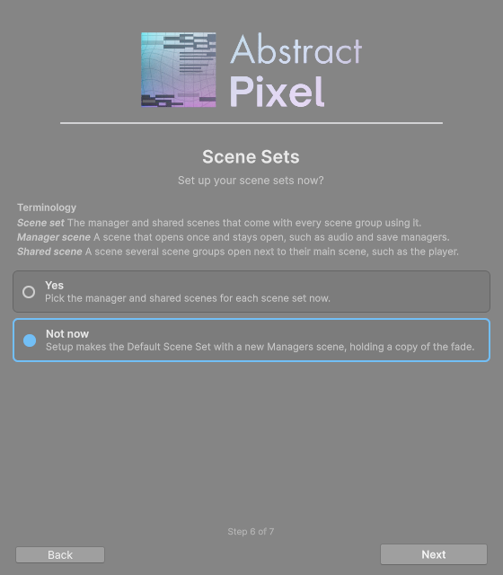

# Get started <!-- level 0 -->

<!-- layout new -->

Set up the scene system once per project, then change scene with one button or one call. This page takes an empty project to its first scene change.

<!-- your-project get-started -->

## Run the setup <!-- level 0 -->

Setup makes the [scene system settings](term:scene-system-settings) asset, a default [scene set](term:scene-set) and, if you want them, a [launch scene](term:launch-scene) and a [loading scene](term:loading-scene). Run it once per project.

**Run it**

1. Open Tools > External Project Tools > Scene System > Set Up Scene System.
2. Answer the seven steps: Scene System, Settings Folder, New Scenes, Launch Scene, Loading Scene, Scene Sets, Opening Scenes.
3. On Ready, press Set up.

> [!TIP]
> The All set page, then the [Scene System page](term:scene-system-page) with the settings asset in its Setup section.

<!-- marks 1@0.5,0.242 "Step: the question this step asks, here whether to set up scene sets now"; 2@0.13,0.32 "Terminology: the new words this step brings in, each with a one-line meaning"; 3@0.5,0.53 "Your answer: Yes picks the scenes for each set now, Not now makes the Default Scene Set with a new Managers scene"; 4@0.5,0.932 "Progress: which of the seven steps you are on"; 5@0.87,0.968 "Next: goes to the following step, on Ready it reads Set up" -->

**Check the result**

<!-- action open-settings "Setup" "Open the Setup section" -->

- **Set up:** a green line in the Setup section once the settings asset exists.
- **Builds can read these settings:** a green line once the asset is in Player Settings > Preloaded Assets, the list a build loads before its first scene.

If it goes wrong

- **The setup window never opened:** it opens by itself only in a project with no settings asset, once per Editor session. Run Set Up Scene System from the menu; in a project that is already set up it shows only the Opening Scenes step.
- **"Builds can't read these settings yet":** the settings asset is missing from Preloaded Assets. Press Fix now in the Setup section, or let the next build add it back.

## Make your first scene group <!-- level 0 -->

A [scene group](term:scene-group) is one place the player can be. Make one from a scene and the scene becomes its [main scene](term:main-scene).

**Try it in the sample**

<!-- action open-sample 01 "Open sample 01" -->

<!-- action select "Packages/com.abstractpixel.library/Modules/SceneManagment/Samples/01 Button Changes Level/Scene Groups/Sample 01 Room AGroup.asset" "Select Room A's group" -->

**Or do it yourself**

1. In the Project window, right-click your level scene and pick Create > Scene Group.
2. Select the new group and look at it in the Inspector: main scene, scene set, Show the loading scene.

> [!TIP]
> A group asset named after the scene, next to it, with no problems listed in its Inspector.

More: what Create > Scene Group does

- **Where:** the group is saved next to the scene and selected.
- **Scene set:** the default scene set, which fills its manager scenes and shared scenes.
- **Build Settings:** the scene is added, or switched on, unless it is Addressable. One Console line says which.
- **Already a main scene:** a scene is the main scene of at most one group, so the existing group is selected instead and a warning is logged.
- **Scenes in a Samples folder:** get a sample scene group, which stays out of builds and keeps its own scenes instead of the default scene set.

## Change scene <!-- level 0 -->

Change scene from a button with `MonoSceneActions.ChangeTo`, or from code with `SceneActions.ChangeTo`. [Change scene](change-scene.md) shows both.

## Pick the start scene group <!-- level 0 -->

The game opens the [start scene group](term:start-scene-group) at launch. Pick it in the Start-up section; no start-up object is needed in any scene.

<!-- action open-settings "Start-up" "Open Start-up" -->

Why it works

- **Before the first scene:** start-up runs from `SceneSystemStartUp` before the first scene loads.
- **Reads the settings:** from Preloaded Assets, then opens the group. See [Start-up](start-up.md) and [design decision 9](../../../../docs/adr/0009-start-up-opens-the-start-scene-group-behind-a-launch-scene.md).

