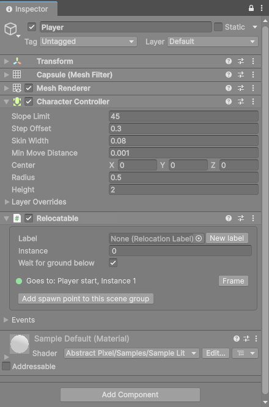
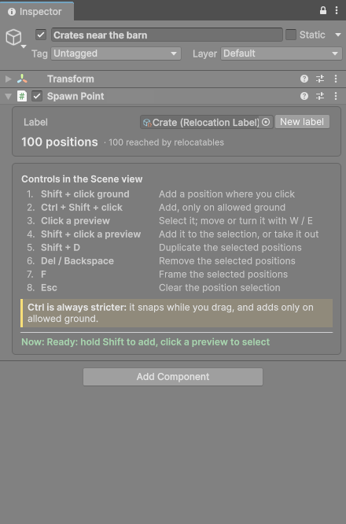

# Relocation <!-- level 0 -->

Move the player and other objects that live in a [shared scene](term:shared-scene) or [manager scene](term:manager-scene) to the right place in each new [scene group](term:scene-group).

## Make an object a relocatable <!-- level 0 -->

Add a `Relocatable` to the object and pick its [relocation label](term:relocation-label), or leave "No label".

**Try it in the sample**

<!-- action open-sample 05 "Open sample 05" -->
<!-- action select-in-scene "Packages/com.abstractpixel.library/Modules/SceneManagment/Samples/05 Persistent Player And Spawn Points/Scenes/Sample 05 Shared.unity" "Player" "Select the Player" -->

<!-- marks 1@0.03,0.586 "Label, and New label"; 2@0.03,0.616 "Instance"; 3@0.03,0.646 "Wait for ground below"; 4@0.03,0.69 "Status: where it goes, or why it stays held" -->

## Add spawn points <!-- level 0 -->

Add a `SpawnPoint` with the same label to each main scene. Its transform is Instance 1; Shift + click the ground in the Scene view adds a [spawn point position](term:spawn-point-position).

<!-- action select-in-scene "Packages/com.abstractpixel.library/Modules/SceneManagment/Samples/05 Persistent Player And Spawn Points/Scenes/Sample 05 Area A.unity" "Crates near the barn" "Select a spawn point" -->

<!-- marks 1@0.03,0.232 "Label"; 2@0.03,0.272 "Positions"; 3@0.03,0.34 "Scene view controls"; 4@0.03,0.65 "The mode in use now" -->

> [!TIP]
> In Play every relocatable jumps to its position and is released once the screen counts as visible.

## Make a relocation label <!-- level 0 -->

Press New label on the Relocatable, or use Assets > Create > Abstract Pixel > Scene System > Relocation Label. Relocatables and spawn points match by label, then by [instance](term:instance).

<!-- marks 1@0.03,0.199 "Colour of its previews"; 2@0.03,0.232 "Steepest ground"; 3@0.03,0.262 "Align to surface" -->

## What happens in a scene change <!-- level 1 -->

1. [Hold](term:hold): physics pauses when the change is accepted.
2. [Relocate](term:relocate): once the new scenes are open, each relocatable moves to its position.
3. [Release](term:release): when the screen counts as visible, physics comes back and `Relocatable.Released` fires.

Listen to `Relocated` and `Released`, or add an `IRelocationHold` component, to pause your own behaviour.

<!-- action open-settings "Relocation" "Open Relocation settings" -->

Why it works

The coordinator calls the [relocation broadcaster](term:relocation-broadcaster) at fixed moments ([design decision 12](../../../../docs/adr/0012-the-coordinator-calls-a-relocation-broadcaster-at-fixed-moments.md)); positions are data, not GameObjects ([design decision 13](../../../../docs/adr/0013-spawn-point-positions-are-data-not-gameobjects.md)); labels are assets, and an object with no position stays held ([design decision 6](../../../../docs/adr/0006-relocation-labels-are-assets-and-missing-positions-hold.md)).

If it goes wrong

- An object stays held with an error → its label has no free position in the main scene; add one.
- It floats or sinks → check the [ground layers](term:ground-layers) in the Relocation section.
- Nothing moves → the scene opened without its group; open it with the scene picker and press Play again.
- A slope warning → the position is steeper than the label's [steepest ground](term:steepest-ground).

## Details <!-- level 3 -->

**What happens in a scene change** (the coordinator calls the relocation broadcaster, ADR 0012):
1. **Hold**, when the change is accepted: rigid bodies turn kinematic with zero velocity, interpolation off, and
   `IRelocationHold` components on the object hear `OnHold`.
2. **Relocate**, once the new scenes are open and before `OnNewSceneGroupTransitionTo`: every relocatable is matched
   to a spawn point position in the open group's main scene by label and instance (a set instance wins, the rest take
   the next free one in Hierarchy order), written in one batch with one `Physics.SyncTransforms`, checked one frame
   later, then, with Wait for ground below, kept held until a collider of the Ground layers is under it. Trails and
   world-space particles are cleared so the jump leaves no streak. A body nested under another held body is left to
   follow its parent.
3. **Release**, when the screen counts as visible: bodies get back their own settings, `IRelocationHold.OnRelease` runs,
   then `Released` fires.

A relocatable that has no position, starts deeper than 0.25 m inside the ground, or sits under a terrain surface stays
held, and one error names it, its label, the scene group and how many positions the main scene has. Every wait counts
unscaled frames, so a paused game (time scale 0) still relocates. Labels match by their ID (the asset GUID, stamped on
import), so the copy of a label that an Addressables bundle carries matches the original.

**Events for game code** on `Relocatable`: `Relocated`, `Released`, and `IsHeld`; `IRelocationHold` for components that pause
their own behaviour. Rally Shift's `CarRelease` turns the
car's controls on at `Released`, and `BombInitializer` starts the bomb there. A game with no relocatable changes scenes
as before: the broadcaster is never registered.
