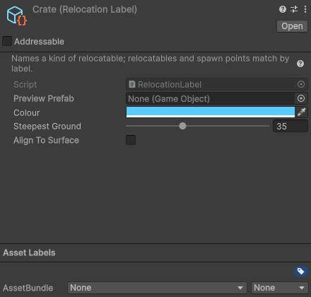

# Relocation <!-- level 0 -->

<!-- layout new -->

Move the player, and other objects that live in a [shared scene](term:shared-scene) or [manager scene](term:manager-scene), to the right place in each new [scene group](term:scene-group).

## Make an object a relocatable <!-- level 0 -->

Add a `Relocatable` component to the object and pick its [relocation label](term:relocation-label), or leave "No label".

**Try it in the sample**

<!-- action open-sample 05 "Open sample 05" -->

<!-- action select-in-scene "Packages/com.abstractpixel.library/Modules/SceneManagment/Samples/05 Persistent Player And Spawn Points/Scenes/Sample 05 Shared.unity" "Player" "Select the Player" -->

<!-- marks 1@0.05,0.524 "Label, and New label"; 2@0.05,0.55 "Instance"; 3@0.05,0.576 "Wait for ground below"; 4@0.05,0.614 "Status: where it goes, or why it stays held" -->

## Add spawn points <!-- level 0 -->

Add a `SpawnPoint` with the same label to each main scene. Its own transform is Instance 1.

**Try it in the sample**

<!-- action select-in-scene "Packages/com.abstractpixel.library/Modules/SceneManagment/Samples/05 Persistent Player And Spawn Points/Scenes/Sample 05 Area A.unity" "Crates near the barn" "Select a spawn point" -->

<!-- marks 1@0.05,0.289 "Label"; 2@0.05,0.336 "Positions"; 3@0.05,0.42 "Scene view controls"; 4@0.05,0.789 "The mode in use now" -->

**Or do it yourself**

1. Add a `SpawnPoint` to an object in the main scene and give it the relocatable's label.
2. To add a [spawn point position](term:spawn-point-position), hold Shift and click the ground in the Scene view.

> [!TIP]
> In Play, every relocatable jumps to its position and is released once the screen counts as visible.

## Make a relocation label <!-- level 0 -->

Press New label on the Relocatable, or use Assets > Create > Abstract Pixel > Scene System > Relocation Label. Relocatables and spawn points match by label, then by [instance](term:instance).

<!-- marks 1@0.03,0.376 "Colour of its previews"; 2@0.03,0.424 "Steepest ground"; 3@0.03,0.471 "Align to surface" -->

## What happens in a scene change <!-- level 1 -->

Three steps, each at a fixed moment of the change. Your code can listen to the last two.

1. [Hold](term:hold): physics pauses when the change is accepted.
2. [Relocate](term:relocate): once the new scenes are open, each relocatable moves to its position.
3. [Release](term:release): when the screen counts as visible, physics comes back and `Relocatable.Released` fires.

<!-- action open-settings "Relocation" "Open Relocation settings" -->

**React in your own code**

- **Events on `Relocatable`:** `Relocated` and `Released`, plus `IsHeld`.
- **Pause your own behaviour:** add a component that implements `IRelocationHold` to the object.
- **Example:** Rally Shift's `CarRelease` turns the car's controls on at `Released`, and `BombInitializer` starts the bomb there.
- **No relocatables:** a game with none changes scenes as before; the broadcaster is never registered.

**Each step in detail**

- **Hold:** when the change is accepted, rigid bodies turn kinematic with zero velocity and interpolation off, and `IRelocationHold` components on the object hear `OnHold`.
- **Match:** once the new scenes are open and before `OnNewSceneGroupTransitionTo`, every relocatable is matched to a spawn point position in the open group's main scene by label and instance. A set instance wins; the rest take the next free one in Hierarchy order.
- **Move:** all positions are written in one batch with one `Physics.SyncTransforms` and checked one frame later.
- **Ground:** with Wait for ground below, the object stays held until a collider on the Ground layers is under it.
- **Clean-up:** trails and world-space particles are cleared, so the jump leaves no streak. A body nested under another held body follows its parent.
- **Release:** when the screen counts as visible, bodies get back their own settings, `IRelocationHold.OnRelease` runs, then `Released` fires.

More: when an object stays held

- **Stays held:** a relocatable with no position, one that starts deeper than 0.25 m inside the ground, or one under a terrain surface.
- **The error:** one Console error names it, its label and the scene group.
- **Paused games:** every wait counts unscaled frames, so a game at time scale 0 still relocates.
- **Labels in Addressables:** labels match by their ID (the asset GUID, stamped on import), so the copy of a label in an Addressables bundle matches the original.

Why it works

- **Fixed moments:** the coordinator calls the [relocation broadcaster](term:relocation-broadcaster) at fixed moments ([design decision 12](../../../../docs/adr/0012-the-coordinator-calls-a-relocation-broadcaster-at-fixed-moments.md)).
- **Positions are data:** not GameObjects ([design decision 13](../../../../docs/adr/0013-spawn-point-positions-are-data-not-gameobjects.md)).
- **Labels are assets:** and an object with no position stays held ([design decision 6](../../../../docs/adr/0006-relocation-labels-are-assets-and-missing-positions-hold.md)).

If it goes wrong

- **An object stays held with an error:** its label has no free position in the main scene. Add one.
- **It floats or sinks:** check the [ground layers](term:ground-layers) in the Relocation section.
- **Nothing moves:** the scene opened without its group. Open it with the scene picker and press Play again.
- **A slope warning:** the position is steeper than the label's [steepest ground](term:steepest-ground).

