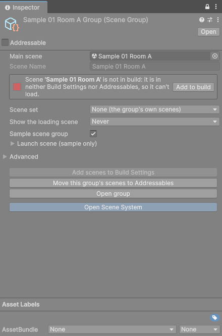

# Scene groups and scene sets <!-- level 0 -->

<!-- layout new -->

A scene group is one place the player can be. A scene set lists the scenes that come with many groups. Edit both in the Inspector and on the [Scene System page](term:scene-system-page).

## Scene groups <!-- level 0 -->

Select a [scene group](term:scene-group) to see its [main scene](term:main-scene), its scene set and what the set fills in.

**Try it in the sample**

<!-- action select "Packages/com.abstractpixel.library/Modules/SceneManagment/Samples/01 Button Changes Level/Scene Groups/Sample 01 Room AGroup.asset" "Select a scene group" -->

<!-- marks 1@0.03,0.212 "Main scene: the one scene that makes this place. It becomes Unity's active scene"; 2@0.03,0.307 "Scene status: whether that scene can load in a build, with a button that fixes it when it can't"; 3@0.03,0.402 "Scene set: the set that fills this group's manager scenes, shared scenes and Reset shared scenes"; 4@0.03,0.445 "Show the loading scene: when a loading scene covers the change into this group"; 5@0.03,0.568 "Advanced: the manager scenes, shared scenes and Reset shared scenes, each following the set or overridden"; 6@0.9,0.698 "Open group: opens the main scene with its manager and shared scenes, as Play would" -->

**Or do it yourself**

1. In the Project window, right-click a scene and pick Create > Scene Group.
2. In the group's Inspector, press Open group. It opens the main scene with everything Play opens with it.

> [!TIP]
> The Hierarchy shows the main scene with its [manager scenes](term:manager-scene) and [shared scenes](term:shared-scene).

If it goes wrong

- **"No main scene":** pick one. A group without a main scene cannot open.
- **A scene shows Not in build:** press its fix button, Add to build or Make Addressable.
- **The same scene is listed twice:** remove one entry.

## Overrides <!-- level 1 -->

Edit a part in the group's Inspector and it becomes an [override](term:override): the group keeps its own value. Press Revert to set to follow the set again.

Why it works

- **Groups keep their own lists:** a group names its set and still stores its own lists, which the loader reads, so changing a set only rewrites groups ([design decision 8](../../../../docs/adr/0008-scene-sets-fill-groups-and-overrides-persist.md)).
- **Where sets live:** in Project Settings ([design decision 2](../../../../docs/adr/0002-scene-sets-live-in-project-settings.md)).

## Reset shared scenes <!-- level 1 -->

Tick [Reset shared scenes](term:reset-shared-scenes) when a shared scene holds per-run state, such as a timer or the player, that must start fresh on each scene change.

## Scene status <!-- level 0 -->

Every scene field shows a [scene status](term:scene-status): In build, Addressable, Not in build or Missing. A scene is In build or Addressable, never both. See [Build Settings and Addressables](build-settings-and-addressables.md).

## Scene sets <!-- level 0 -->

A [scene set](term:scene-set) holds the manager scenes, shared scenes and Reset shared scenes for every group that uses it. Change a set and every group using it follows, except for its [overrides](term:override).

<!-- action open-settings "Scene sets" "Open Scene sets" -->

- **Add:** click + to make "New Scene Set"; its name opens for typing.
- **Rename:** double-click a name, or select its card and press F2.
- **Remove:** select a set and click −. A set no group uses asks once; a set in use, or the default, opens a window that asks what happens to its groups and which set becomes the default.
